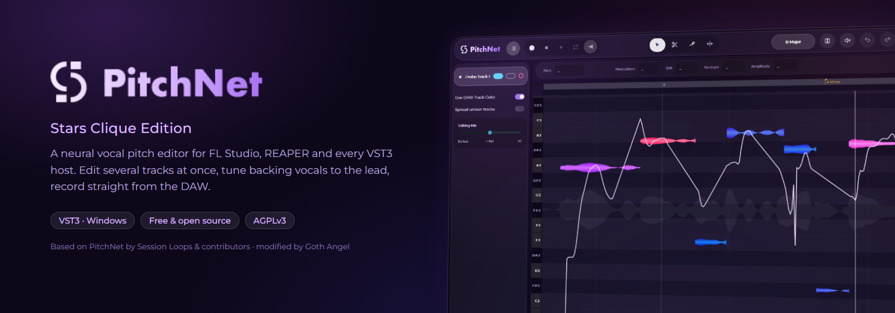
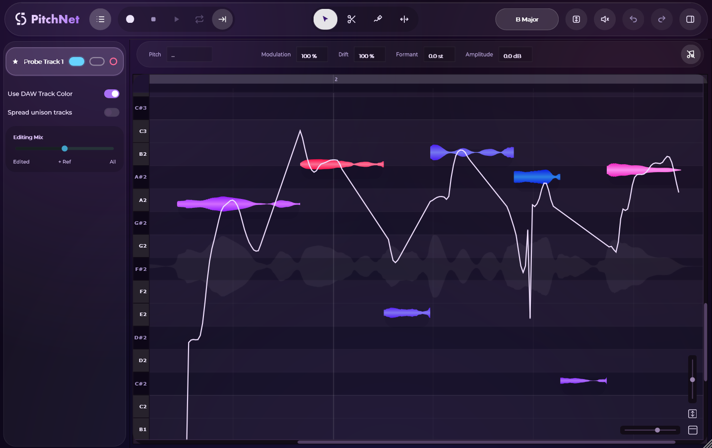
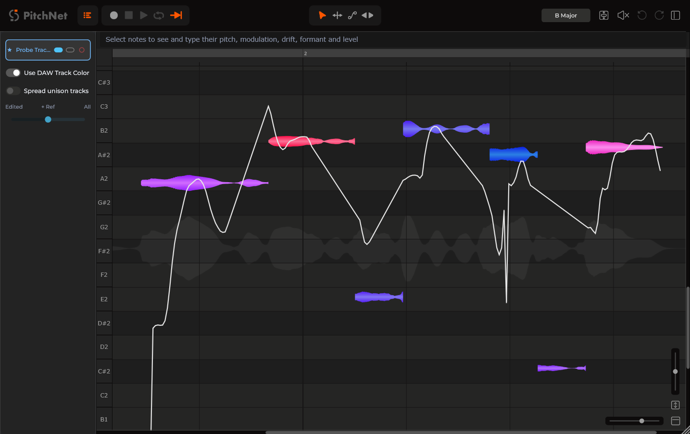

<p align="center">
  
</p>

<p align="center">
  <a href="https://github.com/9519860664r-oss/pitchnet-stars-clique/releases/latest"></a>
  
  <a href="LICENSE"></a>
</p>

<p align="center">
  <b>A neural vocal pitch editor for VST3 hosts.</b><br>
  Edit several vocal tracks at once, tune backing vocals to the lead and record straight from FL&nbsp;Studio or any VST3 host.
</p>

<p align="center">
  <sub>Based on <a href="https://github.com/SessionLoops/PitchNet">PitchNet</a> by Session Loops and contributors, which is based on <a href="https://github.com/KCKT0112/HachiTune">HachiTune</a>. Modified by Goth Angel (Stars Clique).</sub>
</p>

<p align="center">
  <a href="https://github.com/9519860664r-oss/pitchnet-stars-clique/releases/latest"><b>Download the installer</b></a> ·
  <a href="docs/PitchNet-StarsClique-Manual-EN.pdf"><b>User manual (EN)</b></a> ·
  <a href="docs/PitchNet-StarsClique-Manual-RU.pdf"><b>Руководство (RU)</b></a> ·
  <a href="docs/GUIDE.md">Quick start</a> ·
  <a href="CHANGELOG.md">What's new</a>
</p>

---

## About

**PitchNet** was created by **[Session Loops](https://github.com/SessionLoops/PitchNet) and contributors** (Jie Chen, 一支粉笔, KRKT, hrukalive, Steven Cooper, hyperrealist, 暗雨冥), building on **[HachiTune](https://github.com/KCKT0112/HachiTune)** by the HachiTune contributors. It finds the notes in a vocal recording, shows them as blobs on a piano roll and lets you move, stretch, tune and reshape them, with a neural vocoder rendering the result in real time. All of that is their work.

**The Stars Clique Edition** is a modified version by **Goth Angel (Mikhail Mikhalchenko)**, Stars Clique. It adds multitrack editing and recording for hosts without ARA, such as FL&nbsp;Studio, tools for backing vocals and tuning, and a new look. See [CHANGELOG.md](CHANGELOG.md) for what was added.

<p align="center">
  
</p>

## Features

| | |
|---|---|
| 🎚️ **Multitrack in any host** | Every PitchNet instance appears in one track list. Edit as many tracks at once as you like; show the rest as grey ghost notes. |
| 🎙️ **Recording from the DAW** | Transfer records from the DAW: several tracks in one pass, punch in/out, re-record any section, replace ranges. |
| 🎼 **Lead and doubles** | Group a lead with its doubles: **Unison** tunes them to the lead note for note, **Timing** lines them up syllable by syllable, live, even with their windows closed. |
| 🐍 **Sibilants** | "s", "sh", "t", "k" and breaths are found and drawn hatched: they keep their own sound when a note is tuned and their length when it is stretched. Sibilant Balance per note. |
| 🎚️ **Backing vocals to a reference** | Align to a reference track, tune in unison or an interval, level loudness, quantize time. |
| 🎯 **Note Inspector** | Type pitch (`C3`, `F#4 +10`, `+2`), vibrato, drift, formant and level for the selected notes. |
| 🎹 **Keys and tuning** | One key for every track, key changes along the song, A4 from 400 to 480&nbsp;Hz, your own scales with cents. |
| 🧭 **Fast navigation** | Wheel, Shift+wheel, Ctrl+Alt zoom, hand and zoom tools, zoom from the ruler, fit all. |
| 🌌 **Two skins** | Stars Clique (deep violet glass) and the original Classic look. |
| 🧠 **Neural engine, offline** | FCPE pitch detection, GAME note segmentation, PC-NSF-HiFiGAN vocoder. Everything runs on your computer. |

<table>
  <tr>
    <td width="50%"></td>
    <td width="50%"></td>
  </tr>
  <tr>
    <td align="center"><sub>Stars Clique skin, with a key change on the ruler</sub></td>
    <td align="center"><sub>Classic skin</sub></td>
  </tr>
</table>

## Install

1. Download **PitchNet-StarsClique-1.0.0-Setup.exe** from [Releases](https://github.com/9519860664r-oss/pitchnet-stars-clique/releases/latest).
2. Close your DAW and run the installer.
3. Rescan plug-ins in your DAW and add **PitchNet (Stars Clique ver)**.

Windows 10/11 64-bit, any VST3 host (FL Studio, REAPER, Cubase, Studio One, Ableton Live, Bitwig…). About 400&nbsp;MB of disk space.

## Quick start in FL Studio

1. Put PitchNet on the mixer insert of each vocal track.
2. In the track list, click the pink **Transfer** ring of the tracks to record.
3. Play the song. Stop: the notes appear after a short analysis.
4. Turn on the blue **Edit** pill of every track you want to edit; the white pill shows a track as grey ghosts.

The full guide is in the [user manual](docs/PitchNet-StarsClique-Manual-EN.pdf) ([на русском](docs/PitchNet-StarsClique-Manual-RU.pdf)) and in [docs/GUIDE.md](docs/GUIDE.md).

## Build from source

Requirements: CMake 3.22+, Visual Studio 2022 or newer with the C++ workload, Git.

```bash
git clone --recursive https://github.com/9519860664r-oss/pitchnet-stars-clique.git
cd pitchnet-stars-clique
cmake -B build -DCMAKE_BUILD_TYPE=Release
cmake --build build --config Release
```

The VST3 lands in `build/PitchNetPlugin_artefacts/Release/VST3/`. ONNX Runtime and the GAME models are downloaded during configure. The installer is built with [Inno Setup 6](https://jrsoftware.org/isinfo.php) from `packaging/windows/PitchNetStarsClique.iss`; the manuals and images are rendered by `python tools/docs/build.py`.

Optional flags: `-DUSE_DIRECTML=ON` or `-DUSE_CUDA=ON` for GPU inference, `-DPITCHNET_BUILD_TESTS=ON` for the tests (`ctest --test-dir build -C Release`).

## Credits

- **PitchNet** (original authors): Session Loops and contributors: Jie Chen, 一支粉笔, KRKT, hrukalive, Steven Cooper, hyperrealist, 暗雨冥 ([SessionLoops/PitchNet](https://github.com/SessionLoops/PitchNet)).
- **HachiTune**: the HachiTune contributors ([KCKT0112/HachiTune](https://github.com/KCKT0112/HachiTune)), the project PitchNet is derived from.
- **Stars Clique Edition** (modifications): Goth Angel (Mikhail Mikhalchenko), Stars Clique.
- **Models**: [GAME](https://github.com/openvpi/GAME) and [PC-NSF-HiFiGAN](https://github.com/openvpi/vocoders) by Team OpenVPI, [FCPE](https://github.com/CNChTu/FCPE) by CN_ChiTu, [RMVPE](https://github.com/yxlllc/RMVPE) by yxlllc.
- **Libraries**: [JUCE](https://juce.com), [ONNX Runtime](https://onnxruntime.ai), [r8brain-free-src](https://github.com/avaneev/r8brain-free-src) by Aleksey Vaneev, the ARA SDK by Celemony Software GmbH and contributors.

## License

PitchNet Stars Clique Edition is free software under the [GNU Affero General Public License v3](LICENSE) (AGPLv3), like the PitchNet and HachiTune code it is derived from. You may use, study, change and share it. If you convey it or a modified version, you must provide the complete corresponding source under the same license and keep all copyright, license and attribution notices, **including the in-app Credits window**. See [NOTICE.md](NOTICE.md) for the attribution terms and [THIRD_PARTY_NOTICES.txt](THIRD_PARTY_NOTICES.txt) for third-party licenses.

This repository does not claim sole authorship of the derived work.
